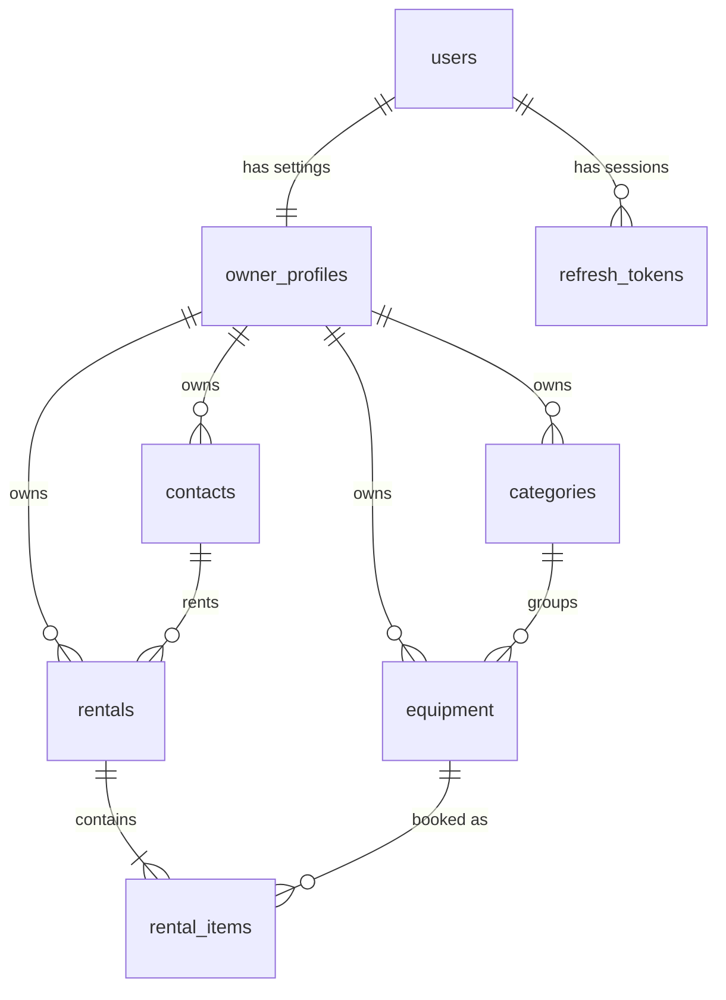

# 03 – Data Model

> **Status:** Draft for approval · **Applies to:** v1
> **Related:** [01 – Product scope](01-product-scope.md) (business rules BR-xx) · [02 – Architecture](02-architecture.md) · [05 – Auth & security](05-auth-and-security.md)

This document defines every table, column, relationship, constraint and index in v1, and the exact rules for **availability**, the calculation most of the business rules depend on.

Naming: C# uses `PascalCase`, and the database uses `snake_case` (via `EFCore.NamingConventions`). Column names below are shown as they appear in the database.

---

## 1. Overview



| Table | Layer that owns the entity | Owned by an owner (`owner_id`)? |
| --- | --- | --- |
| `users` (+ Identity tables) | Infrastructure (`ApplicationUser`) | n/a, the user *is* the owner |
| `refresh_tokens` | Infrastructure | via `user_id` |
| `owner_profiles` | Domain (`OwnerProfile`) | `id` = the owner's user ID |
| `categories` | Domain | Yes |
| `equipment` | Domain | Yes |
| `contacts` | Domain | Yes |
| `rentals` | Domain | Yes |
| `rental_items` | Domain | Yes (repeated from the rental; see §3.3) |

## 2. Conventions used by every table

| Convention | Detail |
| --- | --- |
| **Primary keys** | `id uuid`, generated in C# with `Guid.CreateVersion7()`. Never generated by the database, and never accepted from a client on create. |
| **Audit columns** | `created_at timestamptz NOT NULL` and `updated_at timestamptz NOT NULL`, set in UTC by an EF Core `SaveChanges` interceptor (Infrastructure) using `TimeProvider`. Entities don't set these themselves. |
| **Archiving** | `archived_at timestamptz NULL`. `NULL` means active. There are no hard deletes (BR-20) and no `is_archived` boolean, because the timestamp records *when* as well. |
| **Enums** | Stored as lowercase `text` with a `CHECK` constraint listing the allowed values. Readable in `psql`, and safe to extend. |
| **Money** | `numeric(10,2)`. Maximum 99,999,999.99. Always in the owner's currency (BR-19). |
| **Calendar dates** | `date` ↔ C# `DateOnly`. No time zones are involved. |
| **Instants** | `timestamptz` ↔ C# `DateTimeOffset`, always stored in UTC. |
| **Foreign keys** | `ON DELETE RESTRICT` everywhere. Nothing cascades, because nothing is deleted. PostgreSQL does **not** index foreign-key columns automatically, so each one is indexed explicitly below. |
| **Text limits** | Every `varchar(n)` limit is also a `[MaxLength]` on the request record, so the API rejects oversize input with `400` before it reaches the database. |
| **Domain purity** | Entities have no attributes. All of the mapping below lives in `Infrastructure/Data/Configurations/` (rule A1 in doc 02). |

### Ownership backstop: composite foreign keys

Every owned table has a unique key on `(owner_id, id)`. Child rows reference parents through **`(owner_id, parent_id)`**, not just `parent_id`. As a result, **the database itself refuses** to link, say, owner A's equipment to owner B's category, even if a bug skipped the query filter. This is defence in depth for BR-24, and it costs one extra unique index per table.

## 3. Tables

### 3.1 Identity and sessions (Infrastructure)

**`users`.** Created by ASP.NET Core Identity through `IdentityUserContext<ApplicationUser, Guid>`. This variant has no roles tables, because v1 has no roles. Identity manages the columns: `id`, `email`, `normalized_email` (unique), `password_hash`, `security_stamp`, `concurrency_stamp`, `lockout_end`, `lockout_enabled`, `access_failed_count`, and some unused columns such as phone and 2FA. Identity also creates `user_claims`, `user_logins` and `user_tokens`, which v1 leaves unused.

**`refresh_tokens`.** Full behaviour is in [05 – Auth & security](05-auth-and-security.md).

| Column | Type | Null | Notes |
| --- | --- | --- | --- |
| `id` | uuid | no | PK |
| `user_id` | uuid | no | FK → `users.id` |
| `token_hash` | char(64) | no | SHA-256 hex of the token. **The raw token is never stored.** Unique. |
| `family_id` | uuid | no | Shared by every token in one login's rotation chain. Used to detect reuse. |
| `expires_at` | timestamptz | no | |
| `revoked_at` | timestamptz | yes | Set when the token is used (rotated), on logout, or on reuse detection |
| `replaced_by_id` | uuid | yes | The token issued when this one was rotated |
| `created_at` | timestamptz | no | |

Indexes: unique `(token_hash)`; `(user_id)`; `(family_id)`.

### 3.2 Owner settings and catalogue (Domain)

**`owner_profiles`.** One row per user, created in the same transaction as registration.

| Column | Type | Null | Default | Notes |
| --- | --- | --- | --- | --- |
| `id` | uuid | no | | PK **and** FK → `users.id` (a shared primary key) |
| `display_name` | varchar(80) | no | | |
| `time_zone` | varchar(64) | no | `'America/Edmonton'` | IANA ID. Validated with `TimeZoneInfo.FindSystemTimeZoneById`. Defines "today". |
| `currency_code` | char(3) | no | `'CAD'` | ISO 4217, uppercase. Check `currency_code ~ '^[A-Z]{3}$'`. |
| `created_at`, `updated_at` | timestamptz | no | | |

**`categories`**

| Column | Type | Null | Notes |
| --- | --- | --- | --- |
| `id` | uuid | no | PK |
| `owner_id` | uuid | no | FK → `owner_profiles.id` |
| `name` | varchar(60) | no | As the owner typed it (trimmed) |
| `normalized_name` | varchar(60) | no | `name.Trim().ToUpperInvariant()`, set by the entity. Used for case-insensitive uniqueness (BR-23). |
| `archived_at` | timestamptz | yes | Archived categories can't be assigned to equipment, but existing equipment keeps them |
| `created_at`, `updated_at` | timestamptz | no | |

Indexes: unique `(owner_id, id)`; unique `(owner_id, normalized_name)`.

Archived categories still count toward uniqueness, so they can be un-archived later without clashing.

**Seeded on registration** (as editable rows, not migration data): Audio, Lighting, DJ, Video, Staging, Cables & Accessories, Décor, Other.

**`equipment`**

| Column | Type | Null | Default | Notes |
| --- | --- | --- | --- | --- |
| `id` | uuid | no | | PK |
| `owner_id` | uuid | no | | FK → `owner_profiles.id` |
| `category_id` | uuid | no | | Composite FK `(owner_id, category_id)` → `categories (owner_id, id)` |
| `name` | varchar(120) | no | | |
| `tracking_type` | text | no | | `'individual'` or `'bulk'`. **Can't be changed after creation**, because changing it would invalidate rental history. |
| `serial_number` | varchar(100) | yes | | Individual items only (trimmed, case-sensitive) |
| `quantity_owned` | integer | no | `1` | Always 1 for Individual items. At least 1 for Bulk. Lowering it is guarded by BR-22. |
| `condition` | text | no | `'good'` | Current condition. See the condition scale below and §5.4. |
| `replacement_value` | numeric(10,2) | yes | | **Per unit** for Bulk items. Optional, because owners often don't know it for small stock. |
| `day_rate` | numeric(10,2) | no | | The default rate, copied into each new rental line (BR-15). `0` is allowed for free loans. |
| `notes` | varchar(2000) | yes | | |
| `archived_at` | timestamptz | yes | | BR-08, BR-21 |
| `created_at`, `updated_at` | timestamptz | no | | |

Check constraints:
- `tracking_type IN ('individual','bulk')`
- `condition IN ('new','excellent','good','fair','poor','damaged')`
- `(tracking_type = 'individual' AND quantity_owned = 1) OR (tracking_type = 'bulk' AND quantity_owned >= 1)`
- `serial_number IS NULL OR tracking_type = 'individual'`
- `day_rate >= 0`
- `replacement_value IS NULL OR replacement_value >= 0`

Indexes: unique `(owner_id, id)`; `(owner_id, category_id)`; unique `(owner_id, serial_number) WHERE serial_number IS NOT NULL` (BR-23); `(owner_id, name)`.

**Condition scale** (`ItemCondition` enum, used for equipment and rental lines): `new`, `excellent`, `good`, `fair`, `poor`, `damaged`.

**`contacts`**

| Column | Type | Null | Notes |
| --- | --- | --- | --- |
| `id` | uuid | no | PK |
| `owner_id` | uuid | no | FK → `owner_profiles.id` |
| `full_name` | varchar(120) | no | |
| `email` | varchar(254) | yes | Format checked in the API only. Not unique: two contacts can share a household email. |
| `phone` | varchar(30) | yes | Free text in v1 (no E.164 normalisation) |
| `organization` | varchar(120) | yes | E.g. a church, school or company |
| `notes` | varchar(2000) | yes | |
| `archived_at` | timestamptz | yes | BR-08, BR-21 |
| `created_at`, `updated_at` | timestamptz | no | |

Indexes: unique `(owner_id, id)`; `(owner_id, full_name)`.

Contacts are personal information, and §6 covers how they're handled.

### 3.3 Rentals (Domain)

**`rentals`.** The rental header.

| Column | Type | Null | Default | Notes |
| --- | --- | --- | --- | --- |
| `id` | uuid | no | | PK |
| `owner_id` | uuid | no | | FK → `owner_profiles.id` |
| `contact_id` | uuid | no | | Composite FK `(owner_id, contact_id)` → `contacts (owner_id, id)` |
| `status` | text | no | `'reserved'` | `'reserved'`, `'checked_out'`, `'returned'` or `'cancelled'` |
| `start_date` | date | no | | First rental day, inclusive (BR-01) |
| `due_date` | date | no | | Last rental day, inclusive. The item is free again from `due_date + 1`. |
| `checked_out_on` | date | yes | | Set at checkout (BR-09) |
| `completed_on` | date | yes | | The date the last item was returned (BR-12) |
| `cancelled_at` | timestamptz | yes | | |
| `currency_code` | char(3) | no | | Copied from the owner profile at creation, so a later currency change never relabels old rentals (BR-19) |
| `deposit_amount` | numeric(10,2) | no | `0` | BR-18 |
| `deposit_refunded` | numeric(10,2) | yes | | `NULL` means not yet recorded |
| `fee_adjustment` | numeric(10,2) | no | `0` | Can be negative (BR-17) |
| `fee_adjustment_note` | varchar(500) | yes | | Required by the domain whenever the adjustment isn't zero |
| `notes` | varchar(2000) | yes | | |
| `created_at`, `updated_at` | timestamptz | no | | |
| `xmin` | xid (system column) | | | Optimistic concurrency token, mapped in Infrastructure only (doc 02 §4) |

Check constraints:
- `status IN ('reserved','checked_out','returned','cancelled')`
- `due_date >= start_date` (BR-01)
- `checked_out_on IS NULL OR checked_out_on >= start_date` (BR-09)
- `completed_on IS NULL OR completed_on >= checked_out_on`
- `deposit_amount >= 0`
- `deposit_refunded IS NULL OR (deposit_refunded >= 0 AND deposit_refunded <= deposit_amount)` (BR-18)
- Status consistency:
  - `status = 'reserved'` → `checked_out_on`, `completed_on` and `cancelled_at` are all NULL
  - `status = 'checked_out'` → `checked_out_on` is NOT NULL, and `completed_on` and `cancelled_at` are NULL
  - `status = 'returned'` → `checked_out_on` and `completed_on` are NOT NULL
  - `status = 'cancelled'` → `cancelled_at` is NOT NULL and `checked_out_on` is NULL (only reservations can be cancelled)

Indexes: unique `(owner_id, id)`; `(owner_id, contact_id)`; `(owner_id, status, start_date)`; `(owner_id, status, due_date)` for overdue lookups.

**Not stored:** subtotal, total and days late. These are always **calculated** from the line items and dates (§5.3). Storing them could let them drift out of sync, and calculating them means BR-26 due-date changes reprice automatically.

**`rental_items`.** One line per equipment record per rental.

| Column | Type | Null | Notes |
| --- | --- | --- | --- |
| `id` | uuid | no | PK |
| `owner_id` | uuid | no | Repeated from the rental, for the query filter and the composite FKs |
| `rental_id` | uuid | no | Composite FK `(owner_id, rental_id)` → `rentals (owner_id, id)` |
| `equipment_id` | uuid | no | Composite FK `(owner_id, equipment_id)` → `equipment (owner_id, id)` |
| `quantity` | integer | no | Always 1 for Individual items (the domain checks against the equipment's type) |
| `day_rate` | numeric(10,2) | no | Copied from the equipment when the line is added (BR-15) |
| `condition_out` | text | yes | Set at checkout (BR-09) |
| `condition_out_notes` | varchar(500) | yes | |
| `returned_on` | date | yes | BR-10 |
| `quantity_returned` | integer | yes | BR-11. Missing = `quantity − quantity_returned` (calculated). |
| `condition_in` | text | yes | |
| `condition_in_notes` | varchar(500) | yes | |
| `created_at`, `updated_at` | timestamptz | no | |
| `xmin` | xid (system column) | | Concurrency token (prevents double returns) |

Check constraints:
- `quantity >= 1`
- `day_rate >= 0`
- `condition_out IS NULL OR condition_out IN (…scale…)`, and likewise for `condition_in`
- The return fields are all set together or all NULL: `(returned_on IS NULL) = (quantity_returned IS NULL) AND (returned_on IS NULL) = (condition_in IS NULL)` (BR-10)
- `quantity_returned IS NULL OR (quantity_returned >= 0 AND quantity_returned <= quantity)` (BR-11)

Indexes: unique `(rental_id, equipment_id)` (BR-07: the same equipment can't appear twice in one rental); `(owner_id, rental_id)`; `(owner_id, equipment_id)` (availability).

**Cross-table rules the database can't check** are enforced in the domain and covered by tests:
- `returned_on >= rentals.checked_out_on` and `returned_on <= today` (BR-10)
- An Individual item's line must have `quantity = 1`
- Archived equipment and contacts can't be added (BR-08)

**Removing a line from a reservation** (BR-25) deletes that `rental_items` row. This is the one intentional hard delete in the schema: the line never "happened", because nothing was checked out. Lines on CheckedOut or Returned rentals are never removed.

## 4. Relationships summary

| From | To | Cardinality | Enforced by |
| --- | --- | --- | --- |
| `owner_profiles.id` | `users.id` | 1 : 1 | PK = FK |
| `refresh_tokens.user_id` | `users.id` | many : 1 | FK |
| `categories`, `equipment`, `contacts`, `rentals` `.owner_id` | `owner_profiles.id` | many : 1 | FK |
| `equipment (owner_id, category_id)` | `categories (owner_id, id)` | many : 1 | Composite FK |
| `rentals (owner_id, contact_id)` | `contacts (owner_id, id)` | many : 1 | Composite FK |
| `rental_items (owner_id, rental_id)` | `rentals (owner_id, id)` | many : 1 (at least one per rental) | Composite FK; the "at least one" is checked in the domain |
| `rental_items (owner_id, equipment_id)` | `equipment (owner_id, id)` | many : 1 | Composite FK |

## 5. Calculations

These definitions are the single source of truth for code and tests. `today` always means the current date in the **owner's** time zone (`IOwnerClock`).

### 5.1 Occupancy: which days a rental line holds stock

| Rental status | Line state | Occupies these days | Quantity |
| --- | --- | --- | --- |
| `cancelled` | any | none | 0 |
| `reserved` | | `start_date … due_date` | `quantity` |
| `checked_out` | not returned | `start_date … max(due_date, today)` | `quantity` |
| `checked_out` or `returned` | returned | `start_date … returned_on` | `quantity` |

All ranges are inclusive.

- **BR-02 / BR-03:** the return day is fully occupied, so an item due back (or returned) on Dec 5 is next free on **Dec 6**.
- **BR-04:** an overdue line keeps occupying days up to **today**. It does not block the future indefinitely. Future reservations that would collide with it are *flagged* (BR-14), not refused.
- **BR-05:** an early return shortens the occupied range to the return day.
- **BR-11:** a returned Bulk line occupies its full `quantity` up to `returned_on`, and nothing after that. Missing units therefore make availability over-report until the owner lowers `quantity_owned`. This is deliberate: missing stock is an owner decision.

### 5.2 Availability

For equipment `e` on day `d`:

```text
available(e, d) = e.quantity_owned − Σ quantity of every line of e that occupies d
```

For a date range `from … to`:

```text
available(e, from, to) = min over d in from…to of available(e, d)
```

- Archived equipment is never listed as available (BR-08).
- **Booking check (BR-02, BR-03):** a requested line of quantity `q` is allowed only if `available(e, start, due) ≥ q`, **excluding the rental's own existing lines** when editing (BR-25). For Individual items this simply means `available = 1`.
- **Quantity guard (BR-22):** a new `quantity_owned` must be at least `max over d ≥ today of (Σ occupying quantity on d)`.
- **Implementation note:** PostgreSQL's `generate_series(from, to, interval '1 day')` joined to occupying lines gives a per-day sum in one query. At v1 scale (ranges of days to weeks, hundreds of lines), this is fast with the `(owner_id, equipment_id)` index. The query runs inside the row-lock transaction from doc 02 §4.

### 5.3 Money

```text
rental_days    = due_date − start_date + 1                     (inclusive, BR-01)
line_fee       = day_rate × rental_days × quantity             (BR-16)
subtotal       = Σ line_fee
total          = subtotal + fee_adjustment                     (BR-17)
days_late      = max(0, (returned_on or today) − due_date)     per line; reported only, never charged automatically
missing_qty    = quantity − quantity_returned                  per returned line
```

All arithmetic uses `decimal`. Results are rounded half away from zero to 2 decimal places only when a total is produced. Line fees are exact, because the inputs already have 2 decimal places.

### 5.4 Status derivations (not stored)

| Derived flag | Definition | Rule |
| --- | --- | --- |
| **Overdue (line)** | Rental `checked_out`, line not returned, `due_date < today` | BR-13 |
| **Overdue (rental)** | Any line is overdue | BR-13 |
| **Pickup late** | Rental `reserved` and `start_date < today` | Doc 01 §4 |
| **Conflict warning** | An overdue line's equipment is also on a `reserved` rental with `start_date > due_date` where `available(e, that rental's range)`, computed as if the overdue line stays out until that rental's start, is below 0 | BR-14 |

**Equipment condition after a return:** when an **Individual** line is returned, `equipment.condition` is updated to the line's `condition_in`. Bulk equipment's condition is a general rating that only the owner changes.

## 6. Personal data

The only personal information in v1 is **contact** details (names, emails and phone numbers of people who never signed up) and **owner** emails.

- They're stored only in the tables above, never in logs, error messages or analytics.
- They're isolated per owner (BR-24), and composite FKs make cross-owner links impossible.
- Contacts are archived, not deleted (BR-20). Before Ipamo is opened to anyone beyond the owner's circle, add an "anonymise contact" action that blanks the personal fields while keeping the rental history. That's tracked as a pre-launch item, not a v1 feature.

## 7. Migrations

- Migrations live in `Infrastructure/Data/Migrations/` and are created **per milestone** with descriptive names (`AddCategories`, `AddEquipment`, `AddRentals`…), not as one big initial migration. See [07 – Build plan](07-build-plan.md).
- Every generated migration is **read before it's committed**, to check the expected tables, columns, check constraints and indexes, and that no `DROP` appears that you didn't intend.
- Once a migration is committed to `main`, it's never edited. Mistakes are fixed with a new migration.
- Check constraints are declared in the entity configuration (`ToTable(t => t.HasCheckConstraint(...))`), so they appear in migrations automatically.
